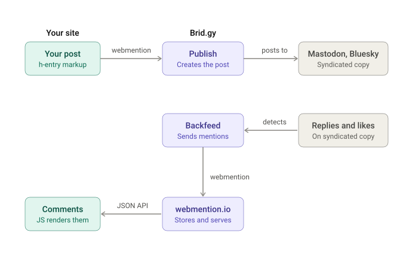

Every Sunday I write about things I learned the previous week. I try to do at least one deep dive on something I'm trying to learn and write it in my own words.  Then I usually share some other random tidbits I picked up last this week.

# Deep Dive

## The Indie Web

This week I ended up going on a bit of a journey into the [indie web](https://indieweb.org).  The concept is relatively straight forward: it's all about owning your own domain and your own content.  I'm a big advocate of having your own site and owning your own domain.  The internet has turned into a bunch of walled gardens that sell your data for profit.  You are not the customer, you're the product.  They lock you in, spy on you, manipulate you with algorithms and lock down your content.  They can lock you out of your own account without notification and leave you with little recourse.  The indie web is all about you taking the power back and this is really what the original promise of the internet was all about.

<figure>
</img>
<figcaption>Source: <a href="https://xkcd.com/1150/" target="_blank">XKCD</a> </figcaption>
</figure>

There are a number of concepts that are key to making the indie web work:

[*Web Sign-In*](https://indieweb.org/Web_sign-in) - using your own web address to sign in to other websites.  This is trivially easy to configure.  Simply add a link to your preferred login site (bluesky, mastadon, github, etc.) with a `rel="me"` attribute to your site's homepage. Then, ensure your profile page on those sites links back to your domain.  That's it. 

[*POSSE*](https://indieweb.org/POSSE) - Post (on your) Own Site, Syndicate Elsewhere.  The idea here is that rather than publishing directly on a social media platform, you publish to your own site and then publish that link to social media (in Indie Web vernacular, social media sites are called [_silos_](https://indieweb.org/silo)).  

*Webmentions* - [an open web standard](https://www.w3.org/TR/webmention/) used to facilitate communication between websites for things like comments, likes, etc.

Additional resources:

- [Indie Webify](https://indiewebify.me/)
- [Bridgy](https://brid.gy/) - captures comments, etc. from social media posts and webmentions them back to your site. (aka [backfeeding](https://indieweb.org/backfeed))
- [Webmention.io](https://webmention.io/) - a hosted service that recieves webmentions for any domain.  Saves you from implementing your own webmention listener.  I'm using webmention.io for jonwhite.me

<figure>
</img>
<figcaption>A possible webmention configuration using webmention.io and brid.gy</figcaption>
</figure>

# Other Stuff

- I watched _You Can See Everything_ and like most people, I couldn't stop thinking about it.  I think [Penny Lane](https://lennypane.substack.com/p/you-can-see-everything-knows-what) had my favorite write-up about the film

- I've always been a big fan of [macro photography](https://arstechnica.com/science/2026/10/meet-the-2026-winner-of-nikons-small-world-photomicrography-contest)

  <h3>AI Disclosure</h3>
  <ul>
    <li>AI was used to build the indie web diagram in this article</li>
  </ul>
  <a href="/pages/about.html">Read my sitewide AI disclosure</a>

