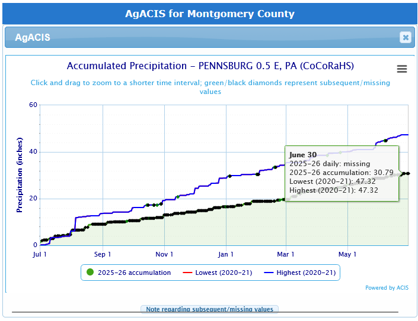

_This is my submission to the November, 2026 IndieWeb Carnival hosted by z1nz0l1n: [Where you at?](https://z1nz0l1n.com/26w44/)_

For this month's indie carnival submission I chose 5 questions from the list of 20 [posed by z1nz0l1n](https://z1nz0l1n.com/26w44/).  My goal was to take a stab at answering them to the best of my ability off the top of my head and then to do some research to see how knowledgable (or, more likely, _ignorant_) I was on the topic.

For reference: I live in Southeastern Pennsylvania, U.S.A not far from Philadelphia and have lived here all my life. 

# Question 1: _What was the total rainfall in your area last year (July-June)?_

## My Guess

~30 inches (~76 cm) - I based this off a guess of approximately 2.5 inches (6 cm) per month

## The Real Answer

I suprised myself on this one.  I kinda _nailed it_.  The real number is: 30.79 inches (78.2 cm) 

<figure>
</img>
<figcaption>Source: <a href="https://agacis.rcc-acis.org/?fips=42091" target="_blank">AGACIS</a>. I'm not sure why lowest and highest are the same. Seems like a bug? </figcaption>
</figure>

# Question 2: _Name 5 native edible plants in your region and their season(s) of availability_

## My Guess

- Spring Onions - available in spring (hence the name...)
- Wild Strawberries - available in spring/summer
- Honeysuckle - available in summer
- Sumac berries - available in summer
- Rhubarb (stem only!) - available in summer

Honeysuckle is the only one I know _for sure_ since I used to pick the flowers on the plants that grew along our dirt road near the house I grew up in and suck the nectar from the them.  The rest are pretty much guesses based on either plants I've seen growing in my yard (Wild Onion, Strawberries) or just a gut feeling (Sumac, Rhubarb)

## The Real Answer

A short list from [PAEats.org](https://www.paeats.org/feature/foraging-in-pennsylvania/):

- Spring:
    - Dandelion flowers and greens (_can't believe I didn't think of this one_)
    - Morels
    - Nettles
    - Ramps
    - Rhubarb stalks (_Nailed It!_)
    - Spruce tips
    - Wild garlic
- Summer:
    - Burdock root
    - Chanterelle mushrooms
    - Honeysuckle (_Nailed It!_)
    - Mulberry
    - Salsify
    - Sunflowers
    - Wild berries (_I did confirm that Sumac fall into this category and are edible_)
    - Wild mint
    - Wood sorrel
- Fall:
    - Barberry
    - Crabapples and other wild apples
    - Hardy kiwi
    - Hen of the Wood and other wild mushrooms
    - Paw paws
    - Persimmon
    - Spicebush
    - Rose hips
    - Wild grapes
- Winter:
    - Wild greens 
    - Black walnuts (_Nuts! Duh!_)
    - Chestnuts
    - Hackberries
    - Juniper berries
    - Chokeberries AKA aronia berries

# Question 3: _When do the deer rut in your region and when are the young born?_

## My Guess

I don't do much hunting anymore but my dad and brother were both deer hunters and I know that the hunting season generally cooresponds with rutting season so my guess is that rutting season is in the fall and I know fawns are born in the spring.

## The Real Answer

Peak Rut is Nov. 10 - 20 with the overall rutting season being from Oct. 22 - Nov 30 and fawns are born in late May or early June.

[Rutting Source](https://www.thehuntbuddy.com/rut-calendar)  
[Fawn Source](https://animalscience.psu.edu/research/areas/deer/photos/fawns )

# Question 4: _What species have gone extinct in your area?_

## My Guess

- Bison of some kind
- Some sort of turtle (_this is just a gut feeling_)
- Game birds of some kind
- Minks or some other victim of the fur trade
- Likely a lot of plants but I'm not even going to try to guess them...

I don't think any of these are extinct but having lived in the area all my life I can say for sure that their numbers are diminished.

- Fireflys (or as we call them here: _Lightning Bugs_) 
- Bats
- Insects in general (I remember my windshield being covered in them during the summer months when I first started driving in the 1990's)

On a more positive side I can say for sure that I'm seeing _more_ of these animals than I did as a kid which is great:

- Red Foxes
- Hawks of all kinds
- Bald Eagles

## The Real Answer

So, this was interesting. I used [this tool](https://www.naturalheritage.state.pa.us/SpeciesFeatures.aspx) at the Pennsylvania Natural Heritage Program website.  I selected the "Pennsylvania Extirpated" filter and then filtered by my county and it came back with a single extirpated species:

The [American Burying Beetle (_Nicrophorus americanus_)](https://www.fws.gov/species/american-burying-beetle-nicrophorus-americanus)

So, I widened the search to include the entire State and got a much longer list of 110 species.  I won't list them all here for brevity's sake but here are some highlights:

- It's mostly plants (98/110)
- I was right about a turtle being on the list - [Midland Smooth Softshell (_Apalone mutica mutica_)](https://explorer.natureserve.org/Taxon/ELEMENT_GLOBAL.2.103992/Apalone_mutica_mutica)
- There are no mammals on the list so I was way off with my mink and bison guesses
- There was only one bird ([Olive-sided Flycatcher](https://explorer.natureserve.org/Taxon/ELEMENT_GLOBAL.2.102228/Contopus_cooperi)) so I was incorrect on my game bird guess

# Question 5: _What were the primary subsistence techniques of the culture that lived in your area before you?_

So, by culture that lived here before me..I’m taking this to mean prior to Europeans coming to the area since much of the culture in my area is of European decent.  In that case, this would be Native Americans, specifically the Lenape (aka Delaware) tribe.

## My Guess

I'm sure they subsisted on some sort of agriculture, hunting, and fishing but I'm not very familiar with the specifics of their methods.

## The Real Answer

They practiced a form of [companion planting](https://en.wikipedia.org/wiki/Companion_planting) consisting mostly of maize(corn), beans, and squash.  They also leveraged [slash and burn agriculture](https://en.wikipedia.org/wiki/Slash-and-burn_agriculture) which produces a nutrient-rich ash that is mixed into the soil.

Deer was the game of choice (not suprising at all considering the number of them still roaming the area) but they also hunted bear and smaller game in the winter months.  They used a number of different hunting techniques one of which was to have large numbers of hunters line up and march toward a river, driving game against the water's edge where they were easier to kill. Per Wikipedia: "Other methods of hunting included lassoing and drowning deer, as well as forming a circle around prey and setting the brush on fire."

Fishing was also previlent, especially on the New Jersey coast where they harvested clams year-round.  Without a doubt, my favorite subsistence method was the following:

> One technique used while fishing was to add ground chestnuts to stream water to make fish dizzy and easier to catch.

All my answers for this question were sourced from the main [Wikipedia article on the Lenape](https://en.wikipedia.org/wiki/Lenape).

# Conclusion

First of all, I just want to thank [@z1nz0l1n](https://mastodon.social/@anthonynelzinsantos) for the idea.  I had a lot of fun with it and certainly learned a lot. I did better than I thought I would:

1. What was the total rainfall in your area last year (July-June)? - *I was off by _less than an inch_!* ✅
2. Name 5 native edible plants in your region and their season(s) of availability - *Every one of my guesses was correct.* ✅
3. When do the deer rut in your region and when are the young born? - *I had the seasons correct at least.* ✅
4. What species have gone extinct in your area? - *Other than my guess about a turtle I was way off on this one.* ❌
5. What were the primary subsistence techniques of the culture that lived in your area before you? - *I had the obvious knowledge of agriculture, hunting, and fishing but no understanding of the specifics.* ❌

I'm clearly no expert on where I'm at but not quite as ignorant as I would have guessed. I may have to go back and answer the rest of those questions now...

